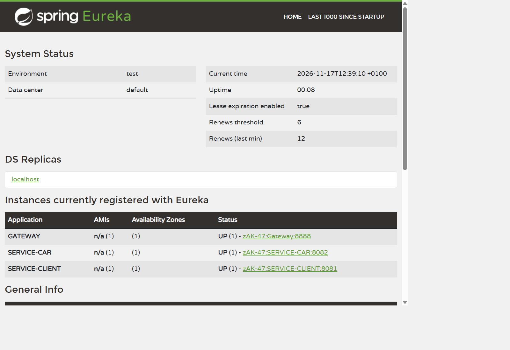
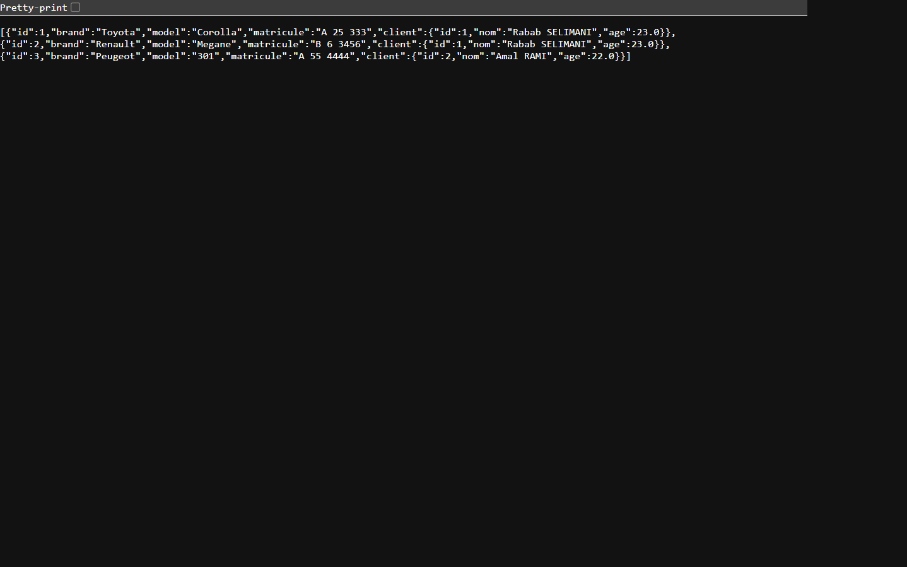

# J2E-TP20 — Architecture microservices avec RestTemplate

TP 20 du cours *Architecture Microservices* — découverte de services **Eureka**, **API Gateway** et communication inter-services avec **RestTemplate**.



## Stack

`Java 17` · `Spring Boot 3.3` · `Spring Cloud 2023.0.3` · `Eureka` · `Spring Cloud Gateway` · `RestTemplate` · `MySQL` · `Lombok`

## Modules

```
J2E-TP20-RestTemplate/
├── eureka-server/    8761  registre de services
├── client-service/   8081  SERVICE-CLIENT : entité Client, /api/client
├── gateway/          8888  Gateway : locator dynamique + raccourcis
└── car-service/      8082  SERVICE-CAR : entité Car + RestTemplate
```

## Architecture

```
                        ┌────────────┐
  GET /SERVICE-CAR/... ►│  GATEWAY   │ 8888
                        └─────┬──────┘
                              │ lb://SERVICE-CAR
                    ┌─────────┴──────────┐
                    ▼                    ▼
            ┌──────────────┐     ┌──────────────┐
            │ SERVICE-CAR  │────►│ SERVICE-CLIENT│
            │  8082 (cars) │Rest │ 8081 (clients)│
            └──────────────┘Template└──────────────┘
                    └──────► Eureka 8761 ◄──────┘
```

## Lancer

```sql
CREATE DATABASE clientservicedb;
CREATE DATABASE carservicedb;
```

```bash
mvn -pl eureka-server   spring-boot:run
mvn -pl client-service  spring-boot:run
mvn -pl gateway         spring-boot:run
mvn -pl car-service     spring-boot:run

mvn test
```

## Endpoints

| Service | URL | Description |
|---|---|---|
| Eureka | <http://localhost:8761/> | tableau de bord |
| SERVICE-CLIENT | `/api/client`, `/api/client/{id}`, POST `/api/client` | CRUD clients |
| Gateway (dynamique) | `http://localhost:8888/SERVICE-CLIENT/api/client` | routage par nom logique |
| Gateway (dynamique) | `http://localhost:8888/SERVICE-CAR/api/car` | routage par nom logique |
| Gateway (raccourci) | `http://localhost:8888/api/car` | route explicite `lb://` |
| SERVICE-CAR | `/api/car`, `/api/car/{id}`, `/api/car/client/{id}` | voitures enrichies |

## Communication RestTemplate

`CarService` appelle SERVICE-CLIENT par son **nom logique** :

```java
private static final String CLIENT_SERVICE_URL = "http://SERVICE-CLIENT/api/client/";

Client client = restTemplate.getForObject(CLIENT_SERVICE_URL + car.getClientId(), Client.class);
```

Le bean est `@LoadBalanced`, ce qui permet à Spring Cloud LoadBalancer de résoudre
`SERVICE-CLIENT` via Eureka (aucun host:port en dur) :

```java
@Bean
@LoadBalanced
public RestTemplate restTemplate() {
    SimpleClientHttpRequestFactory f = new SimpleClientHttpRequestFactory();
    f.setConnectTimeout(5000);
    f.setReadTimeout(5000);
    RestTemplate rt = new RestTemplate();
    rt.setRequestFactory(f);
    return rt;
}
```

En cas d'indisponibilité du service client, l'appel est intercepté : la voiture est
retournée **sans** son propriétaire plutôt que de faire échouer toute la requête.



La réponse contient la voiture et son client :

```json
{"id":1,"brand":"Toyota","model":"Corolla","matricule":"A 25 333",
 "client":{"id":1,"nom":"Rabab SELIMANI","age":23.0}}
```

## Tests

**9/9** — `mvn test` sur le réacteur :

| Module | Tests |
|---|---|
| eureka-server | 1 (contexte) |
| client-service | 3 (POST+GET, 404, persistance de l'âge) |
| gateway | 1 (contexte) |
| car-service | 4 (liste, 404, filtrage par client, mode dégradé) |

## Pièges rencontrés et corrigés

1. **`Could not resolve attribute 'client'`** — le champ Java s'appelait `client_id` alors
   que la méthode dérivée est `findByClientId` : Spring Data cherchait un attribut `client`.
   Le champ est désormais `clientId` avec `@Column(name = "client_id")`, pour garder le nom
   de colonne attendu par l'énoncé.
2. **Spring Cloud 2023.0.5** fournit `spring-cloud-gateway-server 4.1.6`, incompatible avec
   Spring Framework 6.1.14 (`NoSuchMethodError: HttpHeaders.headerSet()`). Le parent épingle
   **2023.0.3**.

Auteur : [zAK4-7](https://github.com/zAK4-7)
